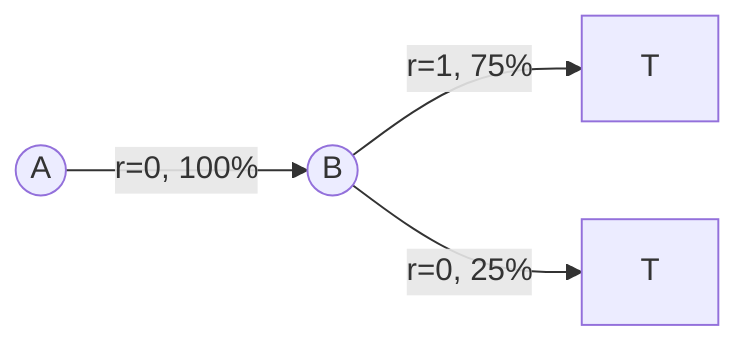
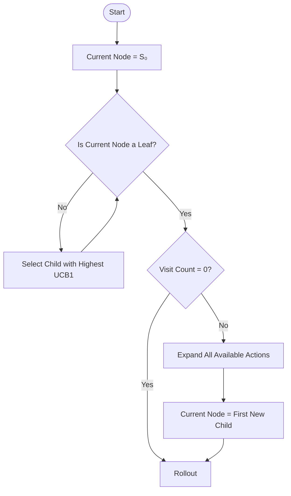
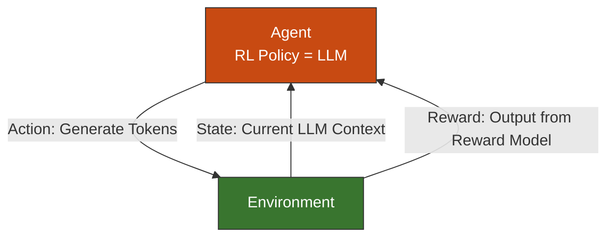
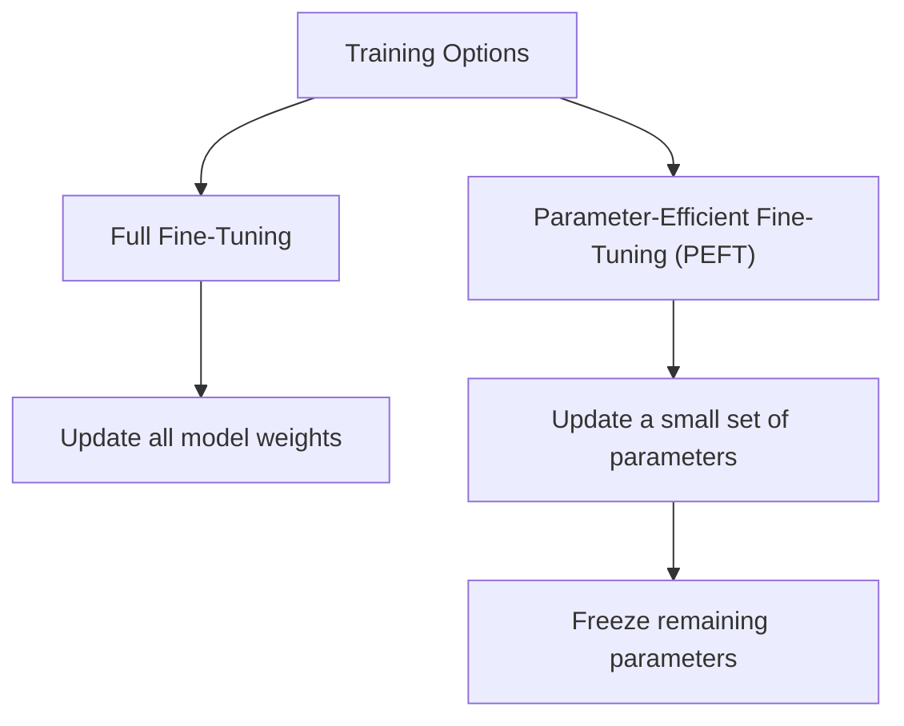
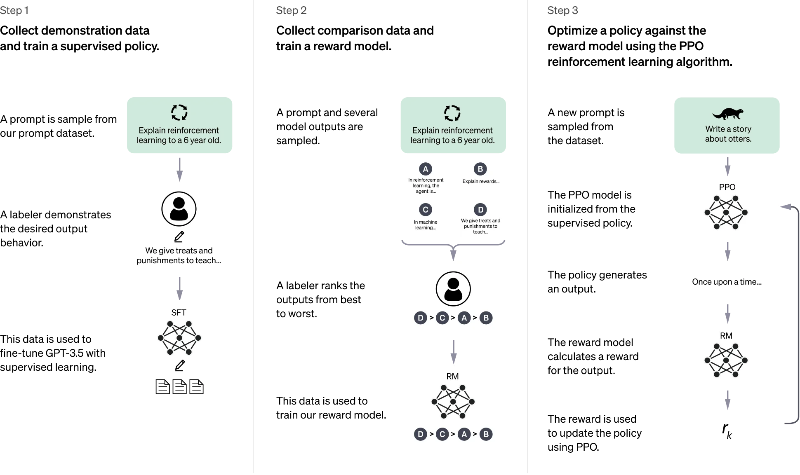

## Model Based RL

- Model: Transition Probability, Reward Function, State, Action, Discount Factor
- Planning: use the learned models to evaluate possible actions, construct or iprove a value function or policy using Value/Policy Iteration.
- **Underlying MDP**: The env's actual state transitions and reward structure.
  - Transition Model $P(s'|s,a)$
  - Reward Model $R(s,a)$
  - Goal: Approximate the env's MDP and use if for planning.

| Aspect | Model-Free RL | Model-Based RL |
| - | - | - |
| **Environment Model** | No model available (transition dynamics) | Learn a model from experience |
| **Learning** | Directly learn a value function and/or policy from experience | Use the learned model to plan a value function and/or policy |
| **Methods** | Learn directly from experience | Use a simulator with DP, Model-Free RL, or Policy Search |

### Advantages of Model-Based RL

- Efficient Model Learning: Supervised learning can efficiently learn transition and reward models from experience.
- Model Uncertainty: The learned model can estimate uncertainty in its prediction

### Disadvantages of Model-Based RL

- Two-Step Process: First learn the environment model, then use it to construct a value function or policy.
- Two Sources of Approximation Error:
  - Approximated Model Error: The learned model may inaccurately predict transitions or rewards.
  - Approximated Planning Error: Planning with the learned model may produce approximate or suboptimal results.
  - Compounding Error: Model and planning errors can accumulate, reducing the accuracy of the final policy.

### MDP Model

$$\text{MDP} = \langle S, A, P, R \rangle_{\eta}$$

- Assumption: State space $S$ and Action space $A$ are known and the env satisfies the Markov property.
- Model $\mu = \langle P_{\eta}, R_{\eta} \rangle$ is parameterized by $\eta$ and represents state-transitions and rewards.
  - $P_{\eta} \approx P$
  - $R_{\eta} \approx R$

$S_{t+1} \sim P_{\eta}(s_{t+1} | s_t, a_t)$
$R_{t+1} \sim R_{\eta}(r_{t+1} | s_t, a_t)$

$$P(s_{t+1}, R_{t+1} | s_t, a_t) = P(s_{t+1} | s_t, a_t) P(R_{t+1} | s_t, a_t)$$

- Assume that the next state and reward are conditionally independent given the current state and action (not a consequence of the Markov property).
- This allows transition and reward distributions to be modeled separately.

## Model Learning

- Goal: Approximate a model $\mu_\eta$ from experience $\{S_1, A_1, R_2, \ldots, S_T\}$.
- Supervised Learning: Use $(S_t, A_t)$ as input and $(R_{t+1}, S_{t+1})$ as targets.
- Loss Function: Measure prediction errors using a loss function (e.g., MSE).
- Empirical Loss: Average prediction error over observed training data.
- Use supervised learning framework, find parameters $\eta$ that minimize empirical loss (MSE).

$$
\eta^* = \arg \min_\eta L(\eta)
$$

## Lookup Table Model

- Underlying Model is presented as a lookup table.
- A model is an explicit $\text{MDP}, \hat{P}, \hat{R}$

$$\hat{P}_{ss'}^a = \frac{1}{N(s,a)} \sum_{t=1}^T 1((S_t, A_t, S_{t+1}) = (s,a,s'))$$

- $N(s,a)$ is the number of times State-Action pair has been visited.
- $1$: Indicator function that is 1 if the condition is true, 0 otherwise.
- $\hat{P}_{ss'}^a$ is the estimated probability of transitioning from state $s$ to state $s'$ under action $a$.

$$\hat{P}(s'|s,a) = \frac{N(s,a,s')}{N(s,a)}$$

- Estimated Transition Probability by counting the number of times the State-Action-Next State tuple has been observed.

$$
\hat{R}_s^a = \frac{1}{N(s,a)} \sum_{t=1}^T 1((S_t, A_t) = (s,a)) R_{t+1}
$$

- Calculate the average reward for the State-Action pair.

### Single Action MRP Example

> Two States $\{A, B\}$ and no discount, 8 episodes of learning.

- A → B: 100% transition probability, reward = 0.
- B → Terminal: 75% chance of reward 1, 25% chance of reward 0.

| Episode | Experience |
| - | - |
| 1 | A, 0, B, 0 |
| 2 | B, 1 |
| 3 | B, 1 |
| 4 | B, 1 |
| 5 | B, 1 |
| 6 | B, 1 |
| 7 | B, 1 |
| 8 | B, 0 |

- **MC**: Estimates values using observed complete returns.
  - $V(B) = 6/8 = 0.75$
  - $V(A) = 0$
- **TD**: Uses bootstrapping, updates a state's value using the estimated value of the next state.
  - $V(B) = 0.75$
  - $V(A) \leftarrow \gamma + \gamma V(B) = 0 + 0.75 = 0.75$
  - Requires a backup of $A$ after $V(B)$ has been learned.

## Planning with a model

- **Given** Model $\mu_\eta = \langle P_{\eta}, R_{\eta} \rangle$
- **Solve** $\text{MDP} \langle S, A, P_{\eta}, R_{\eta} \rangle$ by $\eta$.
- With Planning algorithm:
  - Value Iteration
  - Policy Iteration
  - Tree searching
  - etc.

### Sample-based Planning

- Generate a lot of samples or data then, use model free methods such as MC, SARSA, Q-learning, etc. to plan.
- $S_{t+1} \sim P_{\eta}(S_{t+1} | S_t, A_t)$
- $R_{t+1} \sim R_{\eta}(R_{t+1} | S_t, A_t)$
- Data Efficiency: Reduce real environment interactions by learning from simulated experiences.

## Monte Carlo Search

- Given a model $\mu_v$ and simulated policy $\pi$
- For each $a \in A$:

$$
Q(S_t, a) = \frac{1}{K} \sum_{k=1}^K G_t
$$

- Simulate $k$ episodes from current state $s_t: \{ s_t, a, R_{t+1}^k, \ldots, S_T^k \} \sim \mu_v, \pi$
- Evaluate actions by mean returns (MC evaluation)
- $G_t^{(k)}$: Return from the $k$-th simulation.
- Select current action with max value

$$a_t = \arg\max_{a \in A} Q(s_t, a)$$

e.g.

| Action | Episode 1 | Episode 2 | Episode 3 |
| - | - | - | - |
| Left | 3 | 5 | 4 |
| Right | 2 | 1 | 3 |

- $Q(s_t, \text{Left}) = \frac{3 + 5 + 4}{3} = 4$
- $Q(s_t, \text{Right}) = \frac{2 + 1 + 3}{3} = 2$
- Select action with max value: $\text{Left}$

### Expectimax Tree

- White Node: Choose action with max value.
- Black Node: Average state values of all possible actions.
- Compute Optimal $Q(s,a)$ values for the current state by construction an expectimax tree.

$$
Q(s,a)=\sum_{s'}P_\nu(s'|s,a)
\left[R_\nu(s,a,s')+\gamma V(s')\right]
$$

$$
V(s)=\max_a Q(s,a)
$$

- $P_\nu(s'|s,a)$: Transition probability.
- $R_\nu(s,a,s')$: Expected Reward
- $V(s')$: Value of the next state.

#### Limitations of Expectimax Tree

$$
O((|\mathcal S|\times|\mathcal A|)^H)
$$

- Scaling Exponentially with Depth: Tree size grows exponentially with depth $H$.
- $|\mathcal S|$: Number of possible states.
- $|\mathcal A|$: Number of possible actions.
- $H$: Depth of the tree.

## Monte Carlo Search Tree, MCTS

- Given a model $\mu_v$
- Build a search tree rooted at the current state $s_t$, sample actions and next states.
- Iteratively Construct and update the tree by performing $K$ simulation episodes starting from the root node.
- Once search is finished, select the current action with maximum value in the search tree.

$$a_t = \arg\max_{a \in A} Q(s_t, a)$$

| Aspect | MCTS | Expectimax Tree |
| - | - | - |
| **Expansion** | Construct partial search tree | Construct full search tree up to a given depth |
| **Exploration** | Select branches using UCB | Explore all possible branches |
| **Evaluation** | Estimate values using sampled returns | Calculate expected values using transition probabilities |
| **Action Selection** | Select actions based on estimated values | Select actions with maximum expected values |
| **Computational Cost** | Controlled by simulation budget | Exponential in search depth |
| **Trade-off** | More efficient, but approximate | More exhaustive, but computationally expensive |

### Tree Traversal

$$
Q(s,a,i) = \underbrace{V_i}_{\text{Exploitation}} + \underbrace{c\sqrt{\frac{\ln n(s)}{n(s,a)}}}_{\text{Exploration}}
$$

- Use Upper Confidence Bound (UCB) to select which branches to explore.
- $c$: Exploration coefficient.
- $n(s)$: Number of visits to state $s$.
- $n(s,a)$: Number of visits to state-action pair $(s,a)$.
- **Exploration Bonus**: Encourages selecting less-visited actions.
- **UCB**: Balances exploitation of high-value actions and exploration of less-visited actions.
  - In bandit problems, $c$ is a constant to balance exploration and exploitation.

### Node expansion

- **Add a new child node** to the search tree for an unexplored action.

### Rollout

- Perform a **random simulation** from the expanded node until termination or a depth limit.
- Calculate the total return from the simulation.

$$
\begin{aligned}
& \text{ROLLOUT}(S_i) \\
& \quad \text{Loop: } \\ 
& \quad \quad \text{if } S_i \text{ is a terminal } \\
& \quad \quad \quad \text{return } S_i \\
& \quad \quad \quad \text{else } \\
& \quad \quad \quad \quad A_i = \text{random available action } S_i \\
& \quad \quad \quad \quad S_i = \text{Simulate } (A_i, S_i) \\
\end{aligned}
$$

### Backpropagation

- Propagate the simulation return back through the selected path to the root.
- Update visit counts and estimated values of the visited nodes.

### Advantages of MCTS

- Highly Selective Best-First Search
- Evaluates states dynamically, unlike DP.
- Use Samples to break curse of dimensionality.
- Works for "black box" model.
- Computationally efficient.

## Reinforce Learning with Human Feedback, RLHF

### Why Human Feedback?

- Some tasks do not have clear or automatically measurable rewards.
- Humans can provide:
  - **Preferences:** Choose between two outputs (A > B).
  - **Rankings:** Rank multiple outputs (1st, 2nd, 3rd).
  - **Evaluations:** Judge whether an answer is better or worse.
- **Example:** Evaluating which chatbot response is more polite.

### Alignment Problem

- LLMs are pretrained to predict text, not necessarily to generate useful responses.
- Generated text may be harmful, biased, or factually incorrect.
- Traditional evaluation metrics (e.g., BLEU) do not directly capture human preferences.
- Human feedback helps align model behavior with human preferences for helpfulness, truthfulness, and safety.
- **Example:** A model may generate plausible but impractical coding advice.

### Core Idea of RLHF

- **Human Feedback:** Use human evaluations and preferences to guide model training.
- **Alignment:** Align model behavior with human expectations and preferences.
- **Optimization:** Train models to maximize rewards reflecting human preferences rather than only next-token likelihood.
  - Goal of LLM's pretraining: $\max_\theta \sum_{t}\log P_\theta(x_t | x_{<t})$
    - Maximize the likelihood of the next token.
  - Goal of RLHF: $\max_\theta \mathbb{E}_{y \sim \pi_\theta(\cdot|x)} R(x, y)$
    - Maximize the expected reward of human-preferred responses.
- **Application:** Widely used in NLP and LLM alignment.

### RLHF Training Pipeline

> Pre-training → SFT → Reward Model Training → RL Optimization

1. **Pre-training:** Train a base model on a large text corpus using next-token prediction.
2. **Supervised Fine-Tuning (SFT):** Fine-tune the base model on high-quality instruction-response examples.
3. **Reward Model Training:** Train a reward model using human-labelled preferences to predict response quality.
4. **Reinforcement Learning:** Optimize the model's policy to maximize rewards predicted by the reward model.

### Step 1. Pre-training

- Select a base model pretrained on a massive text corpus.
- Learns general knowledge and language patterns.
- **Limitation:** May produce biased, unsafe, or irrelevant responses.

### Step 2. Supervised Fine-Tuning (SFT)

- **Goal:** Train the base model to follow instructions and generate reasonable responses.
- Collect high-quality demonstration data (instruction, input, output).
- Fine-tune the base model on the curated dataset.
- **Limitation:** Instruction-following does not guarantee alignment with human preferences.

### Step 3. Reward Model Training

- **Goal:** Learn a reward function that reflects human preferences.
- Generate multiple responses for the same prompt.
- Humans compare or rank the responses.
- Train a reward model to assign scores based on human preferences.
- **Example:** A professional, polite response (B) is preferred over a blunt response (A): B > A.
- **Outcome:** Convert human judgments into numerical reward scores.

### Step 4. RL with Human Feedback

- **Goal:** Optimize the LLM policy using the trained reward model.
- **Algorithm:** PPO (example).
- Generate responses using the current policy.
- Score responses using the reward model from Step 3.
- Update the policy to maximize reward.
- Use a KL penalty to limit deviation from the reference policy and reduce over-optimization.
  - KL Penalty: Penalizes large deviations between the updated policy and the reference policy.
  - Higher KL Penalty → More conservative policy updates.

$$
D_{KL}(P\|Q)=\sum_x P(x)\log\frac{P(x)}{Q(x)}
$$

$$
\max_\theta\left[
\mathbb E[R(x,y)]
-\beta D_{KL}(\pi_\theta\|\pi_{\mathrm{ref}})
\right]
$$

### Chatgpt

### Benefits of RLHF

- **Alignment:** Aligns model behavior with human values and preferences.
- **Safety & Usefulness:** Encourages safer, more useful responses with higher human acceptance.
- **Ambiguous Goals:** Handles tasks where rewards are difficult to define explicitly.

### Challenges of RLHF

- **Cost:** Requires extensive human annotations, making training expensive.
- **Human Bias:** Biases in human feedback can be transferred to the reward model and policy.
- **Over-optimization:** Models may exploit the reward function rather than produce genuinely better responses (Reward Hacking).
- **Scalability:** Collecting and applying human feedback becomes difficult as models and tasks scale.

### Applications of RLHF

- ChatGPT: Improvement in safety and helpfulness
- Claude: Constitutional AI for more nuanced alignment
- Gemini: Large-scale RLHF for multimodal capabilities
- Robotics: Learning task from human demonstrations
- Teaching robots via human feedback to cook
- Medical AI systems trained with doctor's feedback to align with human expert medical standards.
