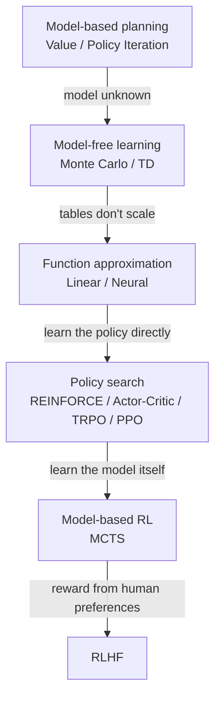
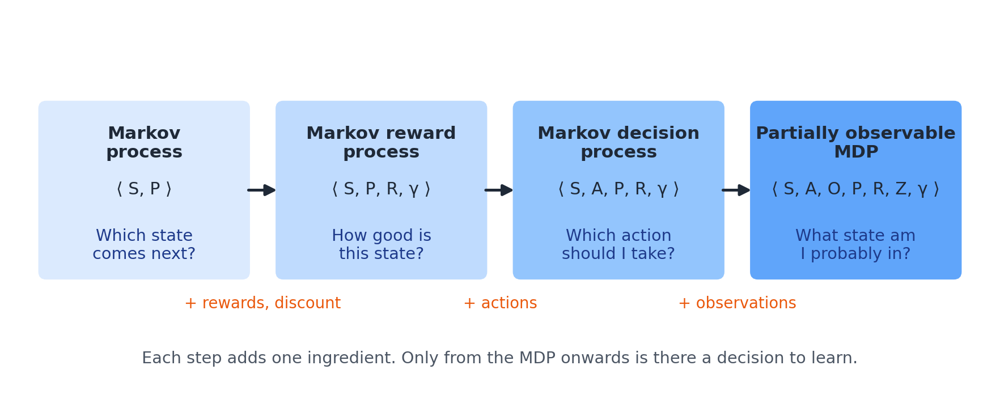
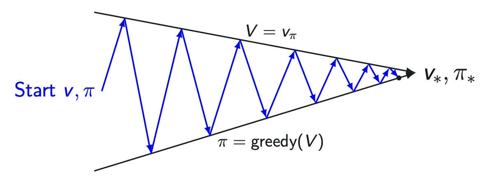
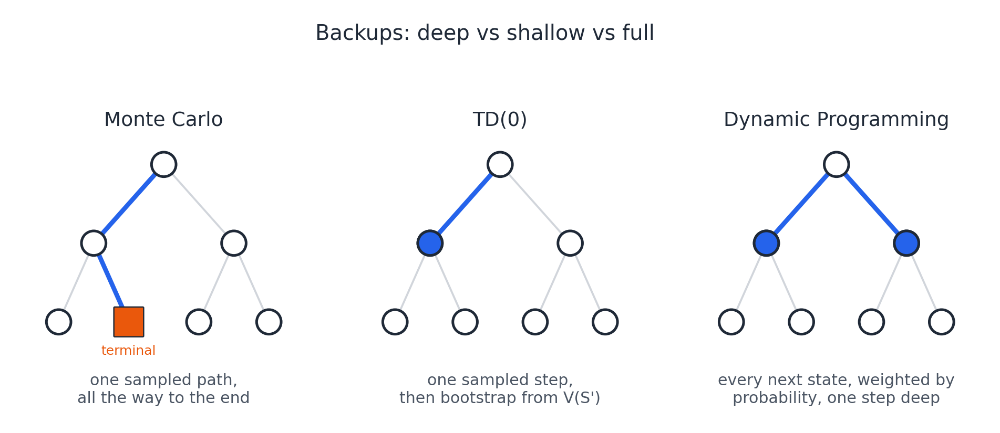
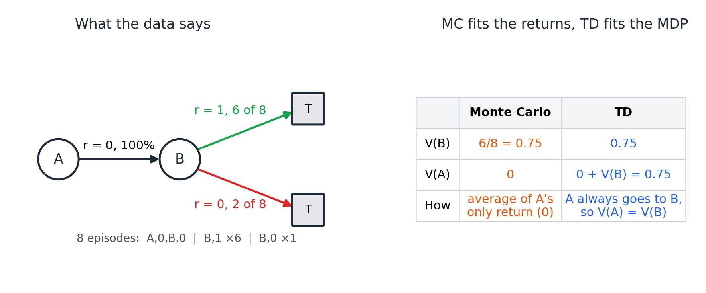
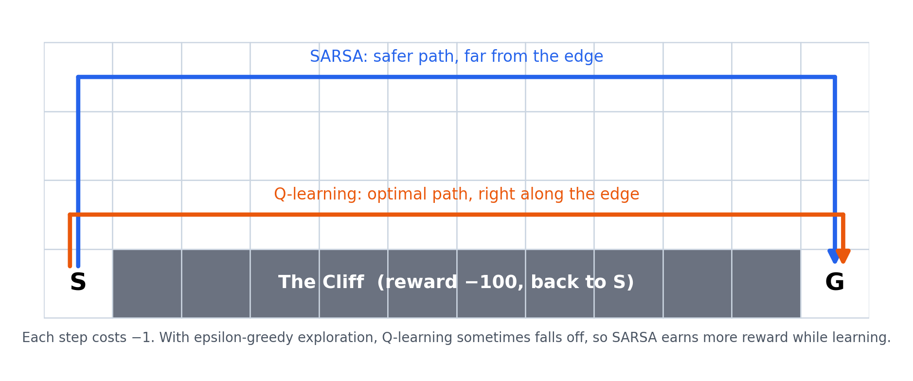
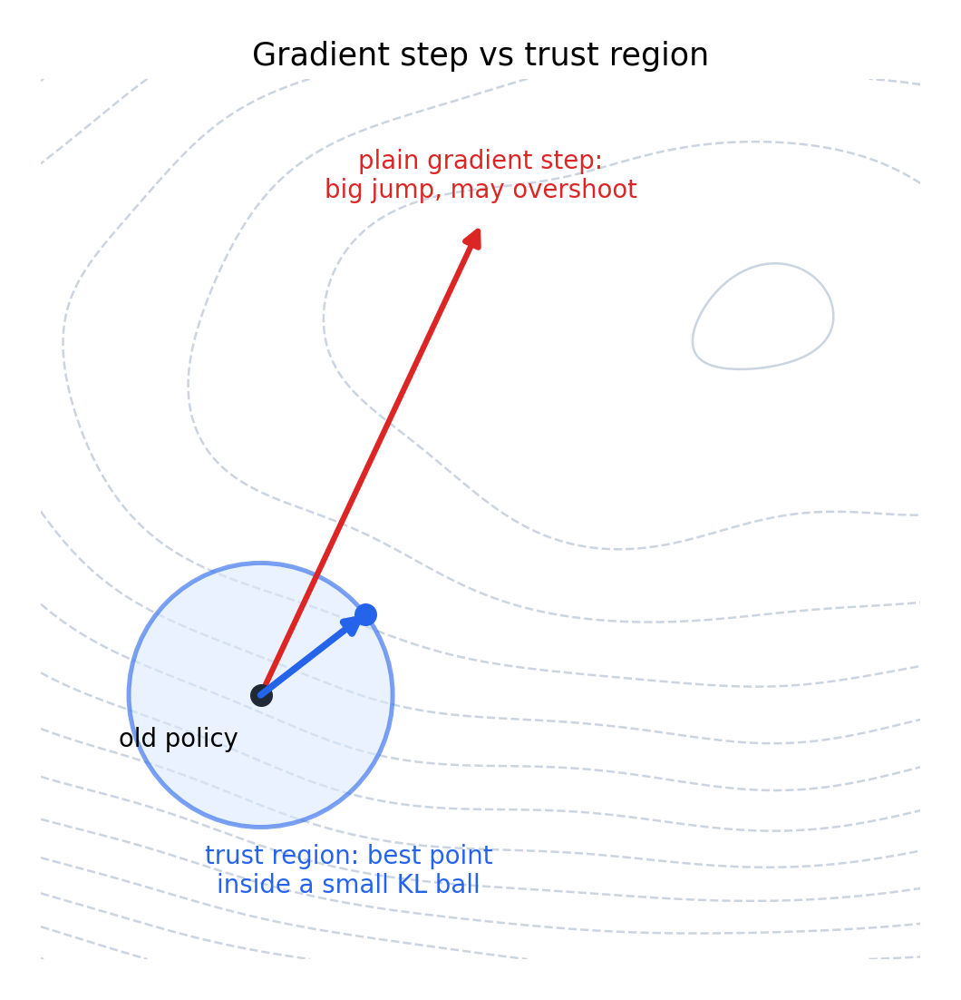
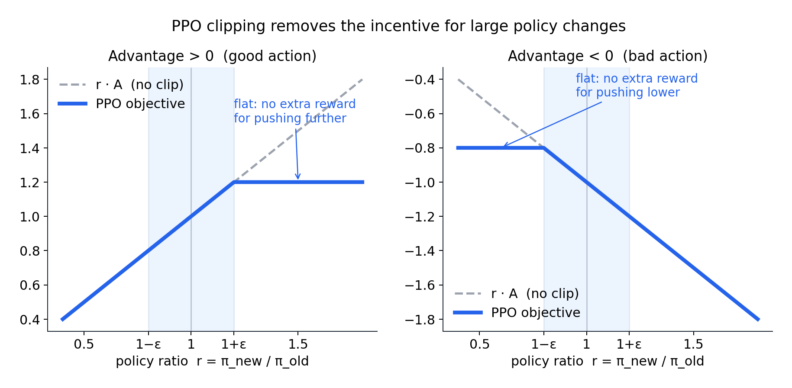
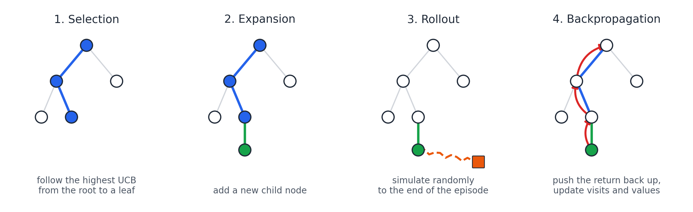
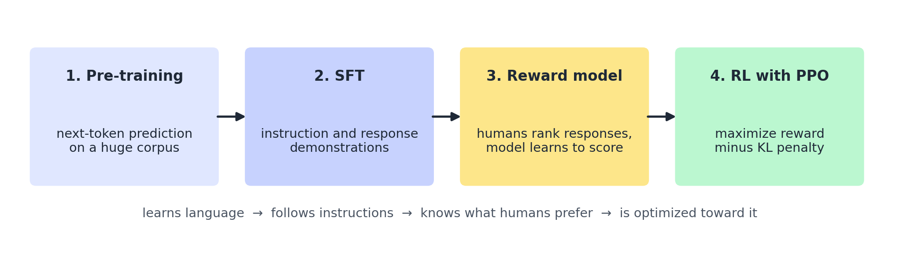

## Sequential Decisions, MDPs and Bandits

- **Decision making**
  - Choosing which action to take at each step, based on what the agent currently knows.
- **Sequential decision making**
  - Making a sequence of decisions in a certain order to maximize the total expected future reward.
  - Actions can have long-term consequences and rewards can be delayed, so sometimes we sacrifice an immediate reward for a bigger long-term gain.
  - *Q. Why do we call RL sequential decision making?*
    - Because the decisions must be made in a certain order. Each decision affects what comes next, and the rewards can be delayed.
- **Agent–environment loop**
  - The cycle where the agent takes an action and the environment sends back an observation and a reward.
  - It repeats every time step.
- **Time step**: $S_t \xrightarrow{A_t} R_{t+1}, S_{t+1}$
  - One turn of the agent–environment loop.
  - At each step the agent is in a state and takes an action, and the environment answers with a reward and the next state.
  - That reward is indexed t+1, because it only arrives after the action.
- **Episode**
  - One run of transitions from a start state to the terminal state.
  - It is one sample of the whole process, and we don't know its length in advance.
- **Reward**
  - A scalar signal that tells the agent how well it did at a time step.
  - The agent's only objective is to maximize the cumulative reward in the long run, so the reward signal defines the goal.
  - *Q. Must a reward be a number?*
    - Yes, it is a scalar, because the agent has to compare rewards and maximize them.
- **Reward design**
  - Defining the reward so that it matches the goal of the task.
  - If the reward is defined properly, the agent learns properly, and if not, the agent is in trouble.
  - It requires understanding the whole sequence problem first.
- **Intermediate rewards**
  - Rewards the agent receives at steps during an episode, before it ends.
  - They give feedback on progress, so the agent learns the sequence faster than with a single final reward.
  - *Q. Can we always give intermediate rewards?*
    - No. In chess, for example, we can't judge a move in the middle of the game, so the only reward is the win, draw or loss at the end.
- **Sparse reward**
  - A reward that comes rarely and unpredictably.
  - The agent only gets meaningful feedback now and then, such as only at the end of a game, so it needs much more exploration to learn.
- **History**: $H_t = O_1, A_1, R_1, \ldots, O_t, A_t, R_t$
  - The sequence of all past observations, actions and rewards up to now.
  - The agent selects actions based on it, but it grows huge very quickly.
- **State**: $S_t = f(H_t)$
  - The information used to decide what happens next.
  - It is a compact summary, a function of the history.
  - There are three kinds, the environment state, the agent state and the Markov state.
- **Environment state**
  - The environment's private representation, which it uses to produce the next observation and reward.
  - It is never shown to the agent.
  - That is why the agent has to learn by trial and error.
- **Trial and error**
  - Trial and error is learning by trying actions, observing the rewards they bring, and repeating the ones that worked.
  - Nobody tells the agent the right action, so this is how RL learns.
  - It needs many trials, and the failures are part of the learning.
- **Agent state**
  - The agent's internal representation, the brain of the agent.
  - It is the information the agent uses to pick the next action.
  - It is the part our RL algorithms build, and we never build the environment.
  - *Q. How does the environment state differ from the agent state?*
    - The environment state is private and never shown to the agent. The agent state is the agent's own representation, and we only build algorithms on the agent side.
  - *Q. What makes a good agent state?*
    - It should be small, but still contain enough information to predict the next state and reward. The full history is always Markov but huge, while a small state is cheap but may lose information, so every choice is a trade-off between information and how hard it is to learn.
- **Markov property**
  - The future is independent of the past given the present.
  - The next state depends only on the current state, not on the history.
- **Markov state**: $\mathbb{P}[S_{t+1} \mid S_t] = \mathbb{P}[S_{t+1} \mid S_1, \ldots, S_t]$
  - A state that has the Markov property.
  - It contains all the useful information from the history, so once we know it, we can throw the history away.
  - *Q. Why is the Markov property useful?*
    - Because the current state carries everything we need. We don't have to store the whole history, which would blow up memory, computation and the amount of data needed.
- **Fully observable environment**: $O_t = S_t^a = S_t^e$
  - An environment where the agent sees the complete environment state.
  - So the agent state is the same as the environment state.
  - This gives an MDP.
- **Partially observable environment and POMDP**: $\langle \mathcal{S}, \mathcal{A}, \mathcal{O}, \mathcal{P}, \mathcal{R}, \mathcal{Z}, \gamma \rangle, \quad \mathcal{Z}_{s'o}^a = \mathbb{P}[O_{t+1} = o \mid S_{t+1} = s', A_t = a]$
  - A partially observable environment is an environment where the agent only sees observations, not the true state.
  - So the agent has to build its own state.
  - In the tuple, $\mathcal{O}$ is the set of observations and $\mathcal{Z}$ the observation function, on top of the MDP's $\mathcal{S}, \mathcal{A}, \mathcal{P}, \mathcal{R}, \gamma$.
  - $\mathcal{Z}_{s'o}^a$ is the probability of seeing observation $o$ after taking action $a$ and landing in state $s'$.
  - It is modeled as a POMDP, an MDP plus a set of observations and an observation function, which gives the probability of each observation after an action lands in a state.
- **Belief state**: $b(s) = \mathbb{P}[S_t^e = s \mid H_t]$
  - A probability distribution over the possible environment states.
  - It is one way to build the agent state in a POMDP, along with keeping the full history or using the hidden state of a recurrent network.
- **Exploration and exploitation**
  - Exploration means trying new actions to learn more about the environment, even if it costs immediate reward.
  - Exploitation means using what we already know to maximize reward.
  - The goal is to find a good policy while balancing the two.
- **Policy**: $\pi(a \mid s) = \mathbb{P}[A_t = a \mid S_t = s]$
  - The agent's behavior, the probability of taking each action in each state.
  - It depends only on the current state.
  - It is learned over many trials and episodes, and it is the RL equivalent of a trained model.
  - *Q. Is a policy just a defined set of rules?*
    - No. A policy is not defined up front. It is an optimized set of actions that the agent learns over many episodes.
- **Multi-armed bandit**
  - A very simplified RL problem with one state, where the action is pulling an arm and the reward is immediate.
  - Past pulls do not influence the next one.
  - The task is to learn the unknown reward probabilities of the arms by trial and error while balancing exploration and exploitation.
- **Greedy**: $Q(A) \leftarrow Q(A) + \frac{1}{N(A)} \left( R - Q(A) \right)$
  - A strategy that always pulls the arm with the highest average reward so far.
  - Each arm's average is updated a little toward every new reward it pays.
  - It never explores, so it can lock onto a sub-optimal arm.
- **Epsilon-greedy**: $A_t = \begin{cases} \arg\max_a Q(a) & \text{with probability } 1 - \epsilon \\ \text{random action} & \text{with probability } \epsilon \end{cases}$
  - A strategy that pulls a random arm with a small probability epsilon to explore, and exploits the best arm the rest of the time.
  - The exploration is random and at a fixed rate.
- **Upper Confidence Bound**: $A_t = \arg\max_a \left[ Q(a) + \sqrt{\frac{2 \ln t}{N(a)}} \right]$
  - A strategy that chooses the arm with the highest estimated value plus an exploration bonus.
  - The bonus is large for arms we have rarely tried and shrinks as we try them more.
  - It follows the idea of optimism in the face of uncertainty, so the exploration is informed instead of random.
  - *Q. How do epsilon-greedy and UCB differ?*
    - Epsilon-greedy explores randomly at a fixed rate. UCB explores in an informed way, by giving a bonus to arms we have tried less, so it finds the best arm faster. Over a very large number of episodes, both end up with similar rewards.
- **Q. Why is RL not supervised learning?**
  - There are no labeled answers. The agent learns by trial and error from rewards, which are often delayed, and it needs many trials.

## Building an MDP step by step

- **State transition matrix**: $\mathcal{P}_{ss'} = \mathbb{P}[S_{t+1} = s' \mid S_t = s]$
  - A square matrix of the probabilities of moving from each state to each next state.
  - Each entry is the probability of moving from one state to another.
  - Each row must sum to one, because it covers every possibility from that state.
- **Markov process (MP)**: $\langle \mathcal{S}, \mathcal{P} \rangle$
  - A random sequence of states over time, where the next state depends only on the current state.
  - In the tuple, $\mathcal{S}$ is the finite set of states and $\mathcal{P}$ is the state transition matrix.
  - It is memoryless, because the history before the current state is not needed.
  - It has no rewards and no actions, so it is not yet RL.
  - It answers the observer's question, which state comes next.
- **Terminal state**
  - The state where the episode ends.
  - Once the agent reaches it, it stays there with probability one, so it is also called an absorbing state.
- **Episodic and continuing tasks**
  - An episodic task has a terminal state, and the environment resets after it ends.
  - A continuing task has no defined end and runs without resets.
- **Markov reward process (MRP)**: $\langle \mathcal{S}, \mathcal{P}, \mathcal{R}, \gamma \rangle, \quad \mathcal{R}_s = \mathbb{E}[R_{t+1} \mid S_t = s]$
  - A model for judging how good each state is, by the rewards collected from it in the long run.
  - It is a Markov chain plus a reward function and a discount factor.
  - In the tuple, $\mathcal{S}$ is the set of states, $\mathcal{P}$ the transition matrix, $\mathcal{R}$ the reward function and $\gamma$ the discount factor.
  - $\mathcal{R}_s$ is the reward we expect at the next step when we are in state $s$.
  - The reward is an expectation, because the process is stochastic.
  - There is still no agent and no decision.
  - It answers the evaluator's question, how good this state is in the long run.
- **Return**: $G_t = R_{t+1} + \gamma R_{t+2} + \gamma^2 R_{t+3} + \cdots = \sum_{k=0}^{\infty} \gamma^k R_{t+k+1}$
  - The total discounted reward from a time step to the end of one episode.
  - It belongs to one episode, so it is an actual value, not an expectation.
  - *Q. Is the goal the reward of one state or of the whole episode?*
    - It is the cumulative return over the whole episode.
- **Discount factor gamma**: $\gamma \in [0, 1]$
  - How much the agent values future rewards compared with immediate ones.
  - It is a number between zero and one, and a reward k steps ahead is multiplied by gamma to the power k.
  - With gamma zero, the agent is myopic and only cares about the immediate reward.
  - With gamma one, the agent is far-sighted and counts every future reward equally, which only works when every episode ends.
  - *Q. How do you choose gamma?*
    - It depends on the problem, and we have to justify it. A smaller gamma puts more weight on near-term rewards, and a larger one on long-term rewards.
  - *Q. How do you stop an agent looping in a high-reward state forever?*
    - Discounting makes repeated rewards shrink. We can also lower the reward after the agent stays too long, so the episode still ends.
- **Value function**: $v(s) = \mathbb{E}[G_t \mid S_t = s]$
  - The goodness of being in a state.
  - It is the expected return from that state onwards, averaged over many episodes.
  - *Q. How does the return differ from the value function?*
    - The return is the actual discounted reward of one episode. The value function is the expected return over many episodes.
- **Markov decision process (MDP)**: $\langle \mathcal{S}, \mathcal{A}, \mathcal{P}, \mathcal{R}, \gamma \rangle, \quad \mathcal{R}_s^a = \mathbb{E}[R_{t+1} \mid S_t = s, A_t = a]$
  - A framework that describes the environment for sequential decision making, so RL algorithms can be run on it.
  - In the tuple, $\mathcal{S}$ is the set of states, $\mathcal{A}$ the set of actions, $\mathcal{P}$ the transition probabilities, $\mathcal{R}$ the reward function and $\gamma$ the discount factor.
  - $\mathcal{R}_s^a$ is the reward we expect at the next step when we take action $a$ in state $s$.
  - It is an MRP plus actions.
  - Both the transitions and the rewards now depend on the action taken.
  - It answers the decision maker's question, which action to take now to maximize the long-term reward.
  - *Q. What are the limitations of MDPs, and how do we address them?*
    - MDPs assume the Markov property, which we can patch with frame stacking or recurrent networks. They assume a known model, which model-free RL removes. They assume finite states and actions and suffer from the curse of dimensionality, which function approximation and deep RL address. They also assume full observability, which POMDPs and belief states address.
- **Transition dynamics**: $\mathcal{P}_{ss'}^a = \mathbb{P}[S_{t+1} = s' \mid S_t = s, A_t = a]$
  - How the environment responds to an action, meaning the probability of each next state given the current state and action.
  - They are independent of the policy.
  - *Q. What is the difference between the policy's action probability and the transition probability?*
    - The policy probability is how likely the agent is to pick an action. The transition probability is how likely that action leads to each next state, and it is set by the environment.
- **State value and action value**: $v_\pi(s) = \mathbb{E}_\pi[G_t \mid S_t = s], \quad q_\pi(s, a) = \mathbb{E}_\pi[G_t \mid S_t = s, A_t = a]$
  - State value is the expected return of being in a state and following the policy.
  - Action value is the expected return of committing to a particular action in that state and then following the policy.
- **Planning and learning**
  - Planning is finding the optimal policy in a known MDP, where the transition probabilities and the reward function are given.
  - Learning is improving the policy from experience in an unknown MDP, where they are missing.
  - In that case the agent has to explore.
  - *Q. If the environment is fully observable, is the agent learning?*
    - Only if the dynamics or rewards are unknown. If the agent also knows the transition probabilities and the reward function, finding the policy is planning, not learning.
- **Q. What does each step of the build-up add?**
  - A Markov process has states and transitions. An MRP adds rewards and discounting. An MDP adds actions. A POMDP adds observations.

## Formulating an MDP

- **Formulating a problem as an MDP**
  - Identifying the states, actions, reward function, transition probabilities and discount factor, and then drawing the state transition diagram.
- **Finite-horizon MDP**: $\max_\pi \mathbb{E}\left[ \sum_{t=0}^{T} \gamma^t R_{t+1} \right], \quad \pi_t(s)$
  - An MDP restricted to a fixed, finite number of steps.
  - Every episode must reach an end state and stop, so the return can't blow up and gamma can be one.
  - Its optimal policy can depend on how many steps are left.
  - *Q. How does a finite-horizon MDP differ from an infinite-horizon one?*
    - A finite-horizon MDP has a fixed end, so gamma can be one and the best action can change with the remaining time. An infinite-horizon MDP runs forever, usually needs gamma below one to converge, and has a policy that doesn't depend on time.

## Dynamic Programming

- **Bellman equation**: $v(s) = \mathcal{R}_s + \gamma \sum_{s'} \mathcal{P}_{ss'} v(s'), \quad v = \mathcal{R} + \gamma \mathcal{P} v \;\Rightarrow\; v = (I - \gamma \mathcal{P})^{-1} \mathcal{R}$
  - The recursive relation that says the value of a state is the immediate reward plus the discounted value of the states that come after it.
  - It breaks the long-term return into one step plus the rest.
  - *Q. What is the Bellman equation for the state-value function used for?*
    - It calculates the expected return of a state under a given policy, as the immediate reward plus the discounted value of the next states. Every DP method is built on it.
  - *Q. Can the Bellman equation be solved directly?*
    - For a given policy it is a linear system, so small MDPs can be solved directly by matrix inversion. But that costs about the cube of the number of states, so large MDPs need iterative methods like DP, Monte Carlo or TD.
- **Bellman expectation equation**: $v_\pi(s) = \sum_a \pi(a \mid s) \left( \mathcal{R}_s^a + \gamma \sum_{s'} \mathcal{P}_{ss'}^a v_\pi(s') \right), \quad q_\pi(s, a) = \mathcal{R}_s^a + \gamma \sum_{s'} \mathcal{P}_{ss'}^a \sum_{a'} \pi(a' \mid s') q_\pi(s', a')$
  - The Bellman equation for a given policy.
  - A state's value is the policy-weighted average of its action values, and an action's value is the immediate reward plus the discounted expected value of the next states.
- **Optimal value function**: $v_*(s) = \max_\pi v_\pi(s), \quad q_*(s, a) = \max_\pi q_\pi(s, a)$
  - The maximum value any policy can achieve from each state.
  - The optimal action-value function is the maximum value achievable after taking a given action in a given state.
- **Optimal policy**: $\pi_*(a \mid s) = \mathbb{1}\left[ a = \arg\max_{a'} q_*(s, a') \right]$
  - A policy whose value is greater than or equal to every other policy's value in all states.
  - Every MDP has at least one, there is always a deterministic one, and all optimal policies share the same optimal value function.
  - *Q. If we know the optimal action-value function, how do we get the optimal policy?*
    - In each state we pick the action with the highest optimal action value. That greedy policy is optimal.
- **Bellman optimality equation**: $v_*(s) = \max_a \left( \mathcal{R}_s^a + \gamma \sum_{s'} \mathcal{P}_{ss'}^a v_*(s') \right), \quad q_*(s, a) = \mathcal{R}_s^a + \gamma \sum_{s'} \mathcal{P}_{ss'}^a \max_{a'} q_*(s', a')$
  - The Bellman equation for optimal values, where a state's value is the best action's immediate reward plus the discounted expected optimal value of the next states.
  - Because of the max, it is non-linear, so it can't be solved by matrix inversion and must be solved iteratively.
  - *Q. What is the difference between the Bellman expectation equation and the Bellman optimality equation?*
    - The expectation equation averages over the actions of a given policy, so it is linear and used for evaluation. The optimality equation takes the max over actions, so it is non-linear and gives the optimal values.
- **Dynamic programming**
  - An optimization method for sequential problems that breaks a big problem into sub-problems and combines their solutions.
  - Dynamic means the sequential part, and programming means optimizing a policy.
  - In RL it solves a known MDP recursively with the Bellman equation.
  - *Q. What are the strengths and limits of DP?*
    - It is guaranteed to converge to an optimal policy in polynomial time, which is far faster than searching every possible policy. But it needs a model, and it becomes impractical for huge state spaces because of the curse of dimensionality.
  - *Q. Can dynamic programming only be applied with perfect information about the environment?*
    - No. DP needs a model of the environment, but that model can be stochastic, and it can be a learned, approximate model, as in model-based RL.
- **Policy evaluation**: $v_{k+1}(s) = \sum_a \pi(a \mid s) \left( \mathcal{R}_s^a + \gamma \sum_{s'} \mathcal{P}_{ss'}^a v_k(s') \right)$
  - Computing the value function of a given policy.
  - It is a prediction problem.
  - It repeatedly applies the Bellman expectation backup to every state until the largest change falls below a small threshold.
  - *Q. How do values propagate during policy evaluation?*
    - Value propagation is how values spread outwards from the states with terminal rewards, one step further with each sweep.
- **Policy improvement**: $\pi'(s) = \arg\max_a q_\pi(s, a) = \arg\max_a \left( \mathcal{R}_s^a + \gamma \sum_{s'} \mathcal{P}_{ss'}^a v_\pi(s') \right)$
  - Making a new policy by acting greedily with respect to the current policy's values.
  - The new policy is at least as good as the old one.
  - *Q. How do you extract a greedy policy from the values?*
    - Greedy policy extraction is getting a policy from the values by picking, in each state, the action that moves toward the highest-valued next state.
- **Policy iteration**: $\pi_0 \xrightarrow{E} v_{\pi_0} \xrightarrow{I} \pi_1 \xrightarrow{E} v_{\pi_1} \xrightarrow{I} \cdots \xrightarrow{I} \pi_*$
  - An algorithm that evaluates the current policy and then improves it by acting greedily on its values.
  - It repeats these two steps until the policy stops changing.
  - *Q. Should value iteration and policy iteration give different policies?*
    - No, both should give the same optimal policy. They differ in convergence speed and in the number of iterations.
  - *Q. Which converges first, the policy or the values?*
    - The policy. It becomes stable after a few iterations, while the values keep changing.
- **Value iteration**: $v_{k+1}(s) = \max_a \left( \mathcal{R}_s^a + \gamma \sum_{s'} \mathcal{P}_{ss'}^a v_k(s') \right)$
  - An algorithm that turns the Bellman optimality equation into an update rule.
  - It keeps updating the values using the best action in each state until the change is tiny, and then extracts the policy by taking the action with the best value.
  - *Q. What is the difference between policy iteration and value iteration?*
    - Policy iteration alternates full policy evaluation and greedy improvement until the policy stops changing. Value iteration skips the separate evaluation, keeps updating the values with the best action, and extracts the policy at the end.
- **Modified policy iteration**
  - Policy iteration that stops the evaluation after a few sweeps before improving.
  - With one sweep it becomes value iteration, and with many sweeps it becomes full policy iteration.
- **Synchronous DP**
  - DP that updates every state from the values of the previous sweep.
  - It keeps two arrays, an old one and a new one.
  - New values are computed only from the old ones, so it needs more memory and more iterations.
- **In-place DP**
  - DP that uses each new value as soon as it is computed.
  - It keeps one array and overwrites values straight away, in any order.
  - New values are used immediately, so it needs less memory and fewer iterations.
  - It still converges as long as every state keeps getting updated.
  - *Q. What is the difference between synchronous and in-place DP?*
    - Synchronous DP uses two arrays and only updates from the old values. In-place DP uses one array and uses the new values immediately, so it converges in fewer iterations. Both converge.
- **Real-time DP**
  - DP that only updates the states relevant to the agent's current trajectory while it acts.
  - It suits large problems where sweeping the whole state space is impossible, and it gives a near-optimal policy for the relevant region.
- **Approximate DP**
  - DP that replaces the value table with a function approximator, such as a linear model or a neural network.
  - It is used to handle the curse of dimensionality.

## Model-free learning with Monte Carlo

- **Model-based and model-free**
  - Model-based methods have or learn the MDP and plan with it by computation.
  - Model-free methods have no access to the dynamics or the reward function.
  - They learn directly from sampled experience.
- **Prediction and control**
  - Prediction is evaluating a given policy to tell how good it is.
  - Control is finding the best policy.
  - *Q. What is the difference between Monte Carlo prediction and control?*
    - Prediction values a fixed policy from episodes. Control finds the optimal policy using Q and epsilon-greedy improvement.
- **Generalized policy iteration**
  - The general loop of evaluation and improvement behind RL control methods.
  - We start with any policy, evaluate it, improve it, and repeat until we reach the optimal value function and the optimal policy.
  - *Q. Why can't we use V for model-free control?*
    - Greedy improvement over V needs a one-step lookahead with the transition matrix, which we don't have. With Q we just pick the best action, so it stays model-free.

- **Monte Carlo methods**
  - Ways of estimating an unknown quantity by random sampling and averaging what we observe.
  - They are useful when an analytical solution is hard or impossible, and more samples give better estimates.
- **Monte Carlo in RL**
  - Learning from complete episodes of experience without bootstrapping.
  - The agent can start anywhere, but each episode must end.
  - *Q. What is the key shift from DP to Monte Carlo?*
    - We drop the assumption that the model is known. We move from planning to learning from episodes.
  - *Q. What is a complete episode, and why does Monte Carlo need one?*
    - It is an episode that reaches a terminal state. Monte Carlo needs the actual return, and that is only known at the end.
  - *Q. What are the limitations of Monte Carlo?*
    - It needs complete episodes, so it only works for episodic tasks and gets feedback late. It also has high variance, so it needs many episodes, and it is impractical when data is expensive. The need for complete episodes is what motivates TD.
  - *Q. Which method is designed for episodic tasks where the reward only comes at the end?*
    - Monte Carlo. It waits until the end of the episode and learns from the actual return, so it doesn't need intermediate rewards.
- **Monte Carlo prediction**: $v_\pi(s) = \mathbb{E}_\pi[G_t \mid S_t = s] \approx \frac{1}{N(s)} \sum_{i=1}^{N(s)} G^{(i)}$
  - Estimating a policy's value as the average of the returns we actually observe, instead of the true expected return.
  - *Q. Where is the policy in Monte Carlo prediction?*
    - The policy generates the sample episodes, and Monte Carlo returns its value function.
  - *Q. Why do we need many episodes?*
    - So that every state is visited often enough to give a stable estimate.
- **First-visit Monte Carlo**
  - Monte Carlo prediction that only counts the first visit to a state in each episode when averaging the returns.
- **Every-visit Monte Carlo**
  - Monte Carlo prediction that counts every visit to a state in each episode.
  - *Q. What is the difference between first-visit and every-visit Monte Carlo?*
    - First-visit only averages the first visit to a state in each episode, so its samples are independent and unbiased. Every-visit averages all the visits, so it uses more data and is simpler, but it is slightly biased with few samples. Both converge as the number of episodes grows.
- **Incremental mean**: $\mu_k = \mu_{k-1} + \frac{1}{k}(x_k - \mu_{k-1}), \quad V(S_t) \leftarrow V(S_t) + \alpha \left( G_t - V(S_t) \right)$
  - A way to update an average a little toward each new return, instead of storing all the returns.
  - With a step size of one over the count it matches the exact average.
  - With a constant step size it becomes a moving average that forgets old experience, which suits non-stationary problems.
  - *Q. Why update the value incrementally instead of overwriting it?*
    - If we overwrote it, the value would only reflect the latest episode.
- **Epsilon-greedy policy improvement**: $\pi(a \mid s) = \begin{cases} \frac{\epsilon}{m} + 1 - \epsilon & \text{if } a = \arg\max_{a'} Q(s, a') \\ \frac{\epsilon}{m} & \text{otherwise} \end{cases}$
  - Making the new policy epsilon-greedy with respect to Q.
  - It exploits the best action with probability one minus epsilon and acts randomly with probability epsilon.
  - The policy improvement theorem says the new policy is better than or equal to the old one.
  - *Q. Why is greedy improvement on Q not enough?*
    - It never explores, so it can get stuck on a sub-optimal action. Epsilon-greedy fixes that.
- **Monte Carlo control**
  - Finding the best policy from complete episodes, without a model.
  - It is GPI with Monte Carlo evaluation of Q and epsilon-greedy improvement after every episode.
  - It doesn't wait for a full evaluation before improving.
  - That is noisier, like SGD compared with batch, but it reaches the optimal Q and policy much faster.
- **GLIE Monte Carlo control**: $\lim_{k \to \infty} N_k(s, a) = \infty, \quad \lim_{k \to \infty} \pi_k(a \mid s) = \mathbb{1}\left[ a = \arg\max_{a'} Q_k(s, a') \right], \quad \epsilon_k = \frac{1}{k}$
  - Monte Carlo control that keeps exploring early on but becomes fully greedy in the end.
  - GLIE stands for Greedy in the Limit with Infinite Exploration.
  - Every state-action pair keeps being visited, and the policy becomes greedy in the limit.
  - In practice we update Q after every episode and decay epsilon, such as one over the episode number.
  - *Q. Why use GLIE instead of a fixed epsilon?*
    - Once we have a good policy we want to exploit it. A fixed epsilon keeps exploring forever, so GLIE decays it.
- **Q. What is the difference between DP and Monte Carlo?**
  - DP is model-based and bootstraps from estimated values, so it has lower variance. Monte Carlo is model-free and uses actual returns from complete episodes, so it has higher variance and needs episodic tasks.

## Temporal Difference Learning, SARSA and Q-learning

- **Temporal Difference learning**
  - A model-free method that, unlike Monte Carlo, learns from incomplete episodes.
  - It takes one step and then immediately updates the previous state's value.
  - It combines Monte Carlo sampling with DP bootstrapping, so it is updating a guess toward a guess.
  - *Q. Why does TD do better in Markov environments?*
    - TD builds the underlying MDP step by step from one-step transitions. Monte Carlo just averages full returns, so it suits non-Markov environments.
- **TD target and TD error**: $V(S_t) \leftarrow V(S_t) + \alpha \big[ \underbrace{R_{t+1} + \gamma V(S_{t+1})}_{\text{TD target}} - V(S_t) \big], \quad \delta_t = R_{t+1} + \gamma V(S_{t+1}) - V(S_t)$
  - The TD target is the immediate reward plus the discounted value of the next state.
  - It uses the real reward for the first step and the current guess for the rest.
  - The TD error is the target minus the current estimate, and the value moves a step toward the target.
  - *Q. Why can't the Monte Carlo update be used directly in TD?*
    - Without a complete episode the full return is unknown. So TD replaces it with the TD target.
  - *Q. What does the step size alpha control?*
    - The step size alpha is how fast the estimate moves toward the target. A constant alpha gives more weight to recent experience.
- **Bootstrapping and sampling**
  - Bootstrapping means updating an estimate from another estimate.
  - TD and DP bootstrap.
  - Monte Carlo uses actual returns instead.
  - Sampling means learning from sampled experience instead of the full model.
  - Monte Carlo and TD sample.
  - DP doesn't sample, because the dynamics are known.
  - *Q. How deep are the backups in TD, Monte Carlo and DP?*
    - A backup is updating a state's value from the states that follow it. TD does shallow one-step backups on one sampled path, Monte Carlo does deep backups along a full sampled path to the end, and DP does full backups over every branch weighted by probability.

- **TD lambda**: $\text{TD}(0) \rightarrow \text{TD}(\lambda) \rightarrow \text{TD}(1) \approx \text{MC}$
  - A method that sits between one-step TD and Monte Carlo, where lambda controls how far into the future it learns from.
  - Lambda zero is TD zero, and lambda one approaches Monte Carlo.
- **On-policy and off-policy**
  - On-policy learning is learning about and improving the same policy that the agent follows.
  - Off-policy learning is following a behavior policy to explore while learning a different target policy, so it can even learn from logs or human demonstrations.
  - *Q. Why is SARSA on-policy and Q-learning off-policy?*
    - SARSA updates with the next action from the policy it follows. Q-learning updates with the max action, which is a greedy target policy, while a separate behavior policy explores.
- **SARSA**: $Q(S_t, A_t) \leftarrow Q(S_t, A_t) + \alpha \left[ R_{t+1} + \gamma Q(S_{t+1}, A_{t+1}) - Q(S_t, A_t) \right]$
  - A TD method that learns the value of the policy it follows and improves that same policy.
  - It is on-policy TD control.
  - The name comes from state, action, reward, next state and next action.
  - The next action comes from the same epsilon-greedy policy that is being improved, and it doesn't need to finish evaluation before improving.
  - *Q. Are SARSA and TD different methods?*
    - No. SARSA is a control algorithm that uses TD to update the Q values.
  - *Q. Can you explain the SARSA update in words?*
    - The target is the immediate reward plus the discounted Q value of the next state and the next action actually taken. We move the current Q value toward that target by alpha times the error.
- **Q-learning**: $Q(S_t, A_t) \leftarrow Q(S_t, A_t) + \alpha \left[ R_{t+1} + \gamma \max_a Q(S_{t+1}, a) - Q(S_t, A_t) \right]$
  - A TD method that learns the optimal action values, whatever policy it uses to explore.
  - It is off-policy TD control.
  - A behavior policy, such as epsilon-greedy, explores.
  - The update uses the maximum Q value at the next state, which is the greedy target policy, so it replaces the actual next action with the best possible one.
  - It directly approximates the Bellman optimality equation.
  - *Q. Can you explain the Q-learning update in words?*
    - The target is the immediate reward plus the discounted maximum Q value at the next state. We move the current Q value toward that target by alpha times the error.
  - *Q. In Q-learning, what does the Q value of a state-action pair represent?*
    - It is the expected cumulative reward of taking that action in that state and then following the optimal policy afterwards.
  - *Q. Will Q-learning be accurate after a few episodes?*
    - No. Q starts as a guess and needs very many episodes, often millions of steps for complex problems.
- **Q. What is the difference between Monte Carlo and TD?**
  - Monte Carlo waits for the end of the episode and learns from the actual return, so it only works for episodic tasks. TD learns after every step from the TD target, so it works for both episodic and continuing tasks. Monte Carlo has high variance and zero bias, while TD has low variance and some bias.
- **Q. Why does Monte Carlo have high variance but zero bias, and TD the opposite?**
  - The Monte Carlo return adds up many random steps, but it is an actual return, so it is unbiased. The TD target only has noise from one step, but it bootstraps from an estimate, so it is biased.
- **Q. Is TD always faster than Monte Carlo?**
  - There is no proof that either one is always faster, so it depends on the problem. In practice TD often learns faster, because it can update after every step instead of waiting for the episode to end.
- **Q. In the AB example, why do Monte Carlo and TD disagree on the value of A?**
  - There are two states. A always goes to B with reward 0, and B ends with reward 1 in six of eight episodes. Monte Carlo saw A once with a return of zero, so it gives zero. TD sees that A always leads to B with a reward of zero, so A gets the same value as B, which is 0.75.

- **Q. What does each of SARSA and Q-learning end up learning?**
  - SARSA learns the value of the policy it actually follows, including its exploration. Q-learning learns the value of the optimal policy, whatever the behavior policy does.
- **Q. Why does Q-learning take the risky path in cliff walking, and when would you choose SARSA?**
  - The max makes Q-learning learn the optimal path regardless of exploration, so it sometimes falls off while exploring. SARSA accounts for exploration and learns the safer path, so I would choose it when safety during learning matters.

## Function Approximation for Model-free Prediction

- **Function approximation and generalization**: $\hat{v}(s, \mathbf{w}) \approx v_\pi(s), \quad \hat{q}(s, a, \mathbf{w}) \approx q_\pi(s, a)$
  - Function approximation is estimating an unknown function from the observations we have, here a function that gives values for states instead of a table.
  - Because it learns from the states the agent has seen, it also gives values for unseen states, which is generalization.
  - A weight vector parameterizes the function, and Monte Carlo and TD still update it.
  - *Q. Are tabular Monte Carlo and TD values exact?*
    - No, they are approximations too. Function approximation does the approximation better and generalizes.
  - *Q. Is approximating the state-value function prediction or control?*
    - It is prediction. It evaluates a given policy by approximating its value function. Control needs action values.
  - *Q. What is the scaling problem that motivates function approximation?*
    - The scaling problem is that tabular methods store one value per state or state-action pair, which doesn't work for huge or continuous spaces like Go, backgammon or Atari. Such spaces can never be visited often enough, and the table blows up the memory.
- **Types of function approximators**
  - Function approximators range from tables, through decision trees and nearest neighbor, to linear combinations of features and differentiable models like neural networks.
  - In RL they must be trainable on non-stationary data.
  - *Q. What are the three approximator configurations?*
    - The first takes a state and outputs its value. The second takes a state and an action and outputs one Q value. The third takes a state and outputs the Q values for all actions, and then we take the max.
  - *Q. Which approximator configuration would you choose?*
    - It depends on the problem. Outputting Q for all actions suits discrete actions and real-time settings like Atari, because one forward pass gives every action value.
- **Gradient descent**: $\mathbf{w} \leftarrow \mathbf{w} - \alpha \nabla_{\mathbf{w}} J(\mathbf{w})$
  - An iterative optimization method that moves the weights against the gradient of the loss to reduce the error between the prediction and the target.
  - The step size controls how far each update goes.
- **Value function approximation with SGD**: $\Delta \mathbf{w} = \alpha \left( v_\pi(S) - \hat{v}(S, \mathbf{w}) \right) \nabla_{\mathbf{w}} \hat{v}(S, \mathbf{w})$
  - Updating the weights after each sampled state, by the step size times the error times the gradient of the prediction.
  - On average this equals the full gradient update.
  - It suits TD's one-step updates, and it also works for Monte Carlo.
- **Oracle target**: $J(\mathbf{w}) = \mathbb{E}_\pi\left[ \left( v_\pi(S) - \hat{v}(S, \mathbf{w}) \right)^2 \right]$
  - The true value of the policy, assumed to be given at first.
  - That makes it supervised learning, which minimizes the mean squared error to that value.
  - It is only a starting assumption to set up the method.
- **Feature vectors**: $\mathbf{x}(S) = \left( x_1(S), \ldots, x_n(S) \right)^\top$
  - A list of numbers that describes a state.
  - We need it because RL has experience, not features.
- **Linear value function approximation**: $\hat{v}(S, \mathbf{w}) = \mathbf{x}(S)^\top \mathbf{w}, \quad \nabla_{\mathbf{w}} \hat{v}(S, \mathbf{w}) = \mathbf{x}(S), \quad \Delta \mathbf{w} = \alpha \left( v_\pi(S) - \hat{v}(S, \mathbf{w}) \right) \mathbf{x}(S)$
  - Approximating the value as a weighted sum of the features.
  - Its gradient is just the feature vector, so the update is step size times error times features.
  - With SGD it converges to an approximate solution, not the exact value function.
  - *Q. How does linear approximation compare with neural networks?*
    - Linear approximation is efficient, but it needs handcrafted features and scales less. Neural networks can handle nonlinear inputs like raw frames, but they are a black box.
- **Monte Carlo and TD targets**: $\text{MC}: \Delta \mathbf{w} = \alpha \left( G_t - \hat{v}(S_t, \mathbf{w}) \right) \nabla_{\mathbf{w}} \hat{v}(S_t, \mathbf{w}), \quad \text{TD}: \Delta \mathbf{w} = \alpha \left( R_{t+1} + \gamma \hat{v}(S_{t+1}, \mathbf{w}) - \hat{v}(S_t, \mathbf{w}) \right) \nabla_{\mathbf{w}} \hat{v}(S_t, \mathbf{w})$
  - Monte Carlo and TD targets are what replace the true value when we train the approximator.
  - We need them because the true value is never given.
  - The Monte Carlo return is an unbiased but noisy sample of the true value, and the TD target is a biased sample.
  - Each state paired with its target becomes a supervised training example.
  - *Q. Why is the Monte Carlo target unbiased and the TD target biased?*
    - The Monte Carlo return is an actual return. The TD target uses an estimate of the next state's value.

## VFA for Control, Experience Replay and DQN

- **Control with function approximation**
  - Finding the best policy when the action values come from a function approximator instead of a table.
  - It is GPI where the Q network does the approximate evaluation and epsilon-greedy does the improvement at every step.
- **Action-value approximation**: $J(\mathbf{w}) = \mathbb{E}_\pi\left[ \left( q_\pi(S, A) - \hat{q}(S, A, \mathbf{w}) \right)^2 \right], \quad \hat{q}(S, A, \mathbf{w}) = \mathbf{x}(S, A)^\top \mathbf{w}$
  - Approximating Q instead of V, using features of the state and action together.
  - The target Q is replaced with the Monte Carlo return or the TD target.
- **Deadly triad**
  - Three ingredients that together can make value learning diverge.
  - They are function approximation, bootstrapping and off-policy learning.
  - *Q. What is wrong with Q-learning plus a neural network?*
    - It is not the max, which is the core of the algorithm. The problem is that the same weights give both the prediction and the target. That causes correlated samples and a moving target, so it can diverge.
  - *Q. What is the deadly triad?*
    - It is function approximation, bootstrapping and off-policy learning used together. Q-learning with a neural network has all three, which is why it can diverge without extra tricks.
- **Batch methods**
  - Methods that store experience as a dataset, sample from it repeatedly to fit the approximator, and then refresh it.
  - They look for the value function that best fits all the stored data.
  - *Q. What problem do batch methods solve?*
    - Sample inefficiency. Incremental updates use each sample once, while batch methods reuse stored experience.
  - *Q. What is sample inefficiency?*
    - Sample inefficiency means using each experience once and then throwing it away, which wastes data.
- **Least squares prediction**: $LS(\mathbf{w}) = \sum_{t=1}^{N} \left( v_t^\pi - \hat{v}(s_t, \mathbf{w}) \right)^2, \quad \mathbf{w}^\pi = \arg\min_{\mathbf{w}} LS(\mathbf{w})$
  - Finding the weights that minimize the sum of squared errors between the approximate values and the target values in the stored dataset.
  - Sampling from the dataset with SGD converges toward this least squares solution.
- **Deep neural networks**
  - Universal approximators built from layers of linear and non-linear transformations and trained end to end with backpropagation.
  - They generalize to unseen states, handle continuous spaces and raw pixels, but they are a black box.
- **Convolutional neural network**
  - A neural network for images.
  - Convolution layers extract features with learned filters, pooling layers shrink the size while keeping important information, and fully connected layers turn the features into the output.
- **Deep reinforcement learning**
  - Using deep neural networks to represent the value function, the policy or the model.
  - RL creates the target, and SGD trains the network to fit it.
- **Non-stationary target**
  - A target that moves every time the weights update.
- **Experience replay**
  - A technique that stores transitions in a buffer and samples them randomly.
  - Each transition is a state, action, reward and next state.
  - Random sampling breaks the correlation between consecutive samples, and experience gets reused.
  - *Q. What limits the replay buffer?*
    - Memory. A bigger buffer holds more experience over a longer horizon.
- **Fixed Q-targets**: $\text{target} = r + \gamma \max_{a'} Q(s', a'; \mathbf{w}^-)$
  - A technique that uses a separate target network, frozen for a while, to give the target.
  - The online network learns toward it, only the online weights are updated, and the weights are copied over periodically.
- **DQN**: $\mathcal{L}(\mathbf{w}) = \mathbb{E}_{(s, a, r, s') \sim \mathcal{D}}\left[ \left( r + \gamma \max_{a'} Q(s', a'; \mathbf{w}^-) - Q(s, a; \mathbf{w}) \right)^2 \right]$
  - A deep RL method that learns Q values straight from raw inputs, such as game frames.
  - It is Q-learning with a deep network, experience replay and fixed Q-targets.
  - On Atari it takes the last four frames as input and outputs Q for every joystick action, with the change in score as the reward.
  - The same architecture and hyperparameters worked across all games, and it reached human level on many of them.
  - *Q. Which DQN technique fixes which problem?*
    - Experience replay with random sampling fixes the correlated samples. Fixed Q-targets fix the non-stationary target.
  - *Q. What is frame stacking, and why is it used?*
    - Frame stacking is feeding several consecutive frames together as one input, because a single frame can't show motion.
- **Q. Why might nonlinear TD diverge when Monte Carlo does not?**
  - TD bootstraps from its own estimates one step ahead. Monte Carlo uses the actual return to the end of the episode.
- **Q. Do these methods converge with function approximation?**
  - Tabular methods converge. Linear approximation converges for prediction and only chatters near the optimum for control, because all values share one weight vector. Nonlinear TD and off-policy TD may diverge. Monte Carlo converges in more cases than TD. It is hard to prove in theory, but in practice it often works.

## Policy Search, REINFORCE, Actor-Critic, TRPO and PPO

- **Policy search**
  - Learning the policy directly, instead of deriving it from V or Q.
  - If all we care about is the optimal behavior, the policy is what we should learn.
  - *Q. Why learn the policy directly instead of a value function?*
    - If all we need is the optimal behavior, the policy can be simpler than the values. It can also be stochastic, and it works in high-dimensional and continuous action spaces.
  - *Q. Is policy search model-based?*
    - No. It is still model-free, and it learns from sampled experience.
- **Parameterized policy**: $\pi_\theta(a \mid s) = \mathbb{P}[a \mid s, \theta]$
  - A function with its own parameters, often a neural network, that takes a state and outputs a probability for each action.
  - It is still model-free.
- **Value-based, policy-based and actor-critic**
  - Value-based methods learn V or Q, and the policy is implicit.
  - Policy-based methods only learn the policy.
  - Actor-critic methods learn both.
  - *Q. What is the difference between value-based and policy-based methods?*
    - Value-based methods derive a usually deterministic policy from V or Q. Policy-based methods learn the policy directly, have better convergence and can be stochastic, but they usually reach a local optimum and don't generalize well.
- **Gradient-based and trust-region methods**
  - Gradient-based methods update the policy by following the policy gradient directly.
  - REINFORCE, actor-critic and DDPG are gradient-based.
  - Trust-region methods also use the policy gradient, but restrict how big each update can be.
  - TRPO and PPO are trust-region methods.
  - *Q. Why do we need trust-region methods at all?*
    - A gradient can point in a really bad direction, so one unbounded update can give a really bad policy. A trust region keeps each update small, so the policy doesn't jump off the cliff.
  - *Q. Are TRPO and PPO really gradient-free?*
    - No. They are sometimes called non gradient based, but they still use the policy gradient. What changes is that the update is constrained or clipped.
- **Deterministic and stochastic policies**: $\pi(s) = a \quad \text{vs} \quad \pi(a \mid s) = \mathbb{P}[A_t = a \mid S_t = s]$
  - A deterministic policy maps each state to exactly one action.
  - A stochastic policy gives a probability for each action, so it is more general.
  - Sometimes the optimal policy is random, and value-based methods usually can't learn that because they derive one deterministic action.
  - Rock-Paper-Scissors is one example, because a deterministic policy is easily exploited.
  - Another is two states that look identical, where a deterministic policy picks the same, sometimes fatal, action in both.
- **Policy objective**: $J_1(\theta) = v_{\pi_\theta}(s_1), \quad J_{avV}(\theta) = \sum_s \mu_{\pi_\theta}(s) v_{\pi_\theta}(s), \quad J_{avR}(\theta) = \sum_s \mu_{\pi_\theta}(s) \sum_a \pi_\theta(a \mid s) \mathcal{R}_s^a$
  - A measure of how good the policy is.
  - For episodic tasks it is the expected return from the start state.
  - For continuing tasks it is the average value or the average reward per step, weighted by how often the agent visits each state.
- **Gradient ascent**: $\Delta \theta = \alpha \nabla_\theta J(\theta)$
  - Climbing the gradient of the objective.
  - We use it because RL maximizes reward instead of minimizing a loss.
- **Gradient-free policy search**
  - Optimizing the policy without gradients, using methods like hill climbing or genetic algorithms.
  - They exist but are less predictable.
- **Score function**: $\nabla_\theta \pi_\theta(s, a) = \pi_\theta(s, a) \frac{\nabla_\theta \pi_\theta(s, a)}{\pi_\theta(s, a)} = \pi_\theta(s, a) \nabla_\theta \log \pi_\theta(s, a)$
  - A way to estimate the policy gradient from sampled episodes.
  - It measures how sensitive the policy is to a change in its parameters, and tells us which direction makes an action more likely.
- **Policy gradient theorem**: $\nabla_\theta J(\theta) = \mathbb{E}_{\pi_\theta}\left[ \nabla_\theta \log \pi_\theta(s, a) \, Q^{\pi_\theta}(s, a) \right]$
  - The result that tells us how to compute the gradient of the objective in a multi-step MDP.
  - The gradient is how the policy changes times how good the action is, measured by its action value.
  - It holds for the start value, average value and average reward objectives.
- **REINFORCE**: $\Delta \theta_t = \alpha \nabla_\theta \log \pi_\theta(s_t, a_t) \, G_t$
  - The Monte Carlo policy gradient method.
  - It plays a full episode, then makes the actions that led to a high return more likely and the actions that led to a low return less likely.
  - It uses the return as an unbiased sample of the action value, so it has low bias but high variance and is slow to converge.
  - *Q. What kind of policy does REINFORCE use?*
    - A stochastic policy. It outputs action probabilities and pushes up the probability of actions that led to higher returns.
- **Actor-critic**: $\delta = r + \gamma Q_{\mathbf{w}}(s', a') - Q_{\mathbf{w}}(s, a), \quad \theta \leftarrow \theta + \alpha \nabla_\theta \log \pi_\theta(s, a) Q_{\mathbf{w}}(s, a), \quad \mathbf{w} \leftarrow \mathbf{w} + \beta \delta \phi(s, a)$
  - A method where an actor learns the policy and a critic judges the actor's actions.
  - The actor holds the policy and acts.
  - The critic estimates the value function with Monte Carlo or TD and gives feedback through the TD error.
  - In GPI terms the critic evaluates and the actor improves.
  - *Q. How does actor-critic improve on REINFORCE?*
    - The critic's value estimate replaces the noisy full return, and that reduces the variance.
  - *Q. What does the critic's TD error do?*
    - It tells the actor whether its action was better or worse than expected. It is used to update both the critic and the actor.
- **Advantage function**: $A(s, a) = Q(s, a) - V(s)$
  - How much better an action is than the average action in that state.
  - It is Q minus V.
  - It is used in TRPO, PPO and other deep RL methods.
  - *Q. Why use the advantage function in policy gradient methods?*
    - Because it reduces the variance of the policy updates. It focuses the update on how much better an action is than average, not on the raw value.
- **KL divergence**: $D_{KL}(P \parallel Q) = \sum_x P(x) \log \frac{P(x)}{Q(x)}$
  - A measure of how much one probability distribution differs from another.
  - In TRPO it measures how far the new policy has moved from the old one.
- **TRPO**: $\max_\theta \hat{\mathbb{E}}_t\left[ r_t(\theta) \hat{A}_t \right] \quad \text{s.t.} \quad D_{KL}\left( \pi_{\theta_{old}} \parallel \pi_\theta \right) \le \delta$
  - A policy search method that only accepts an update if the new policy stays within a trust region, measured by the KL divergence from the old policy.
  - It is conservative and stable, but computationally expensive.
  - *Q. How does a trust region differ from plain gradient descent?*
    - Gradient descent picks the steepest direction and moves a fixed step. A trust region first defines how far it is safe to move and then finds the best point inside that region.
  - *Q. Isn't a trust region just a smaller step size?*
    - No. The step size controls the speed. The trust region limits how far the new policy can move away from the old one.
  - *Q. When would you use TRPO or PPO?*
    - For complicated, continuous state and action spaces, where learning the policy directly is the goal.

- **PPO**
  - A policy search method that clips the policy ratio to a small range around one, instead of computing a trust region.
  - It is simpler and much faster than TRPO.
  - *Q. What is the difference between TRPO and PPO?*
    - TRPO enforces a KL trust region at every iteration, which is stable but expensive. PPO clips the policy ratio instead, which is simpler and much faster.
  - *Q. What is the main purpose of clipping in PPO?*
    - Clipping prevents excessively large policy updates. It removes the benefit of pushing the policy ratio beyond the clip range, so the new policy stays close to the old one.
  - *Q. Is the epsilon in PPO the same as in epsilon-greedy?*
    - No. In PPO it sets the clipping range and is usually around 0.1 or 0.2. It is not an exploration rate.
- **Clipped surrogate objective**: $J^{CLIP}(\theta) = \hat{\mathbb{E}}_t\left[ \min\left( r_t(\theta) \hat{A}_t, \; \text{clip}\left( r_t(\theta), 1 - \epsilon, 1 + \epsilon \right) \hat{A}_t \right) \right]$
  - PPO's objective, which rewards better actions but stops rewarding the policy for moving too far from the old one.
  - It is the policy ratio times the advantage, with the ratio clipped.
  - If an action was better than expected, PPO increases its probability but gets no extra benefit beyond the clip range, and the same in the other direction.
  - So clipping removes the incentive for very large updates.
  - *Q. What is the policy ratio?*: $r_t(\theta) = \frac{\pi_\theta(a_t \mid s_t)}{\pi_{\theta_{old}}(a_t \mid s_t)}$
    - The policy ratio is the probability of an action under the new policy divided by its probability under the old policy. One means no change, above one means the action became more likely, and below one means less likely.

- **Q. What are the problems with vanilla policy gradient?**
  - Each update creates a new policy, so the data is non-stationary. The step size is also hard to choose. If it is too big, the next data comes from a bad policy and it may never recover. If it is too small, experience is used inefficiently.
- **Q. Why not use experience replay in on-policy policy gradient?**
  - The stored data comes from older, different policies, but the update needs data from the current policy.

## Model-based RL, MCTS and RLHF

- **Model-based RL**
  - An approach that learns the transition dynamics and the reward model from experience, and then plans with them using value iteration, policy iteration or tree search.
  - So learning and planning are combined.
  - *Q. What is the difference between model-free and model-based RL?*
    - Model-free RL learns a value function or a policy directly from experience. Model-based RL learns a model and then plans with it.
  - *Q. What are the advantages and the weakness of model-based RL?*
    - Learning the model is an efficient supervised problem, and the model can also estimate its own uncertainty. But it is a two-step process, and the model error and the planning error compound.
  - *Q. What is a model?*
    - The model is the MDP itself, meaning the states, actions, transition probabilities, reward function and discount factor. Model-based RL tries to approximate the environment's underlying MDP.
- **Model learning**: $(S_t, A_t) \rightarrow (R_{t+1}, S_{t+1}), \quad \eta^* = \arg\min_\eta L(\eta)$
  - Fitting the model from experience as a supervised learning problem, with the state and action as input and the reward and next state as targets.
  - Predicting the reward is regression, and predicting the next state is density estimation.
  - *Q. How do we get the experience to learn a model?*
    - By interacting with the environment, collecting either complete Monte Carlo episodes or one-step TD transitions.
- **Table lookup model**: $\hat{\mathcal{P}}_{ss'}^a = \frac{N(s, a, s')}{N(s, a)}, \quad \hat{\mathcal{R}}_s^a = \frac{1}{N(s, a)} \sum_{t=1}^{T} \mathbb{1}\left[ S_t = s, A_t = a \right] R_{t+1}$
  - The simplest model, a table of transition probabilities and rewards estimated from experience.
  - It estimates the transition probabilities by counting how often each next state follows each state-action pair, and the rewards by averaging.
- **Parameterized model**: $S_{t+1} \sim \mathcal{P}_\eta(S_{t+1} \mid S_t, A_t), \quad R_{t+1} \sim \mathcal{R}_\eta(R_{t+1} \mid S_t, A_t)$
  - A learned approximation of the environment's MDP, with its own parameters.
  - It is made of a transition model and a reward model.
  - It assumes the state and action spaces are known, the Markov property holds, and the next state and the reward are conditionally independent, so they can be modeled separately.
- **Sample-based planning**
  - Using the learned model only as a simulator to generate experience.
  - Model-free methods, such as Q-learning, then learn from that experience, which reduces real interactions with the environment.
- **Simple Monte Carlo search**: $Q(s_t, a) = \frac{1}{K} \sum_{k=1}^{K} G_t^{(k)}, \quad a_t = \arg\max_a Q(s_t, a)$
  - A search that uses a model and a simulation policy to simulate many episodes from the current state for each action, and takes the action with the highest average return.
- **Expectimax tree**: $Q(s, a) = \sum_{s'} \mathcal{P}(s' \mid s, a) \left[ \mathcal{R}(s, a, s') + \gamma V(s') \right], \quad V(s) = \max_a Q(s, a), \quad O\left( (|\mathcal{S}| |\mathcal{A}|)^H \right)$
  - A full search tree from the current state where action nodes take the max and chance nodes take the expected value over next states.
  - It computes optimal Q values for the current state, but its size grows exponentially with depth.
  - *Q. How does MCTS differ from an expectimax tree?*
    - An expectimax tree expands every branch up to a depth and computes exact expectations, so it is exhaustive but exponential in depth. MCTS builds a partial tree, picks branches with UCB and estimates values from sampled returns, so it is approximate but its cost is controlled by the simulation budget.
- **Monte Carlo Tree Search**: $\text{UCB}(s, a) = \underbrace{\bar{V}_i}_{\text{exploitation}} + \underbrace{c \sqrt{\frac{\ln n(s)}{n(s, a)}}}_{\text{exploration}}$
  - A model-based search that puts the current state at the root and grows a partial search tree by simulating episodes with the model.
  - Then it takes the action with the highest value.
  - AlphaGo and AlphaZero use it.
  - *Q. Is MCTS used in model-free RL?*
    - No. MCTS needs a model to simulate episodes from the current state, so it is a model-based planning method.
  - *Q. What are the four steps of MCTS?*
    - Selection with UCB, then expansion with a new child node, then a random rollout to the end, and finally backpropagation of the return to the root, updating visit counts and values along the path.
  - *Q. In UCB, which part is exploitation and which is exploration?*
    - The average value is exploitation, and the bonus term for less-visited actions is exploration. Calling the average value exploration is a common mistake.
  - *Q. Why does MCTS build only a partial tree?*
    - The full tree is too large, so it only expands where UCB points.
  - *Q. What are the strengths and limits of MCTS?*
    - It is a highly selective best-first search that evaluates states dynamically, uses samples to break the curse of dimensionality and works with a black-box model. But it needs a finite horizon and clear rules, and the tree has to fit in memory, so it suits games like Go but not every problem.
  - *Q. What is a rollout?*
    - A rollout is a random simulation from a newly expanded node until the episode ends or a depth limit is reached, giving a return for that node.

- **Alignment problem**
  - The gap between what an LLM is trained to do, predicting likely text, and what humans want, useful and safe answers.
  - So its output can be fluent but still incorrect, biased or harmful.
  - Traditional metrics like BLEU don't capture human preferences either.
- **RLHF**: $\text{Pre-training}: \max_\theta \sum_t \log P_\theta(x_t \mid x_{<t}), \quad \text{RLHF}: \max_\theta \mathbb{E}_{y \sim \pi_\theta(\cdot \mid x)}\left[ R(x, y) \right]$
  - Fine-tuning a model with RL using a reward learned from human preferences.
  - Pre-training maximizes the likelihood of the next token, while RLHF maximizes the expected reward of human-preferred responses.
  - In RL terms the policy is the LLM, the state is the context, the action is generating tokens, and the reward comes from the reward model.
  - *Q. Why not train an LLM with an automatic reward or with likelihood alone?*
    - Most prompts have no automatic reward, and likelihood only predicts text. RLHF pushes the output toward what humans prefer.
  - *Q. What are the four steps of the RLHF pipeline?*
    - Pre-training, then supervised fine-tuning, then reward model training, and finally RL optimization with an algorithm like PPO.
  - *Q. What are the benefits of RLHF?*
    - Responses align better with human behavior and values, they are safer and more acceptable, and it handles tasks where the reward is hard to define. It also means less content moderation and higher user satisfaction.
  - *Q. What are the challenges of RLHF?*
    - Human labeling is costly, human bias gets carried into the reward model and the policy, the model can hack the reward, and it is hard to scale feedback to large models.

- **Human feedback**
  - Human judgment given as preferences between two outputs, rankings of several outputs, or evaluations of whether an answer is better or worse.
  - *Q. Why collect preferences rather than numeric scores?*
    - A numeric score might not represent the preference correctly. Choosing the better of two responses captures it directly.
- **Pre-training**
  - Training the model on a massive corpus with next-token prediction to learn language and general knowledge.
  - Its output can still be biased, irrelevant or unsafe.
- **Supervised fine-tuning**
  - Fine-tuning the model on high-quality instruction and response demonstrations so that it follows instructions.
  - But following instructions doesn't guarantee alignment with human preferences.
  - *Q. What does SFT give that pre-training does not, and what is still missing?*
    - SFT gives instruction following. It still lacks human preferences, which the reward model and the RL step add.
- **Reward model**
  - A model that scores responses the way humans would.
  - Humans compare or rank several responses to the same prompt, and the reward model is trained on those preferences, so it turns human judgment into a numeric reward function.
  - *Q. Why is the reward model central to RLHF?*
    - It is the only source of reward for the policy. If it is wrong, PPO optimizes the wrong behavior.
- **RL fine-tuning with PPO**
  - The step where PPO updates the LLM to get a higher score from the reward model.
  - The policy generates responses, the reward model scores them, and a KL penalty stops the policy drifting too far from the reference model.
  - *Q. What is the KL penalty?*: $\max_\theta \; \mathbb{E}\left[ R(x, y) \right] - \beta D_{KL}\left( \pi_\theta \parallel \pi_{ref} \right)$
    - The KL penalty is a term that penalizes the updated policy for moving far from the reference policy. A higher penalty gives more conservative updates and reduces over-optimization.
  - *Q. Why does the RL fine-tuning step need a penalty?*
    - Without it, the policy can change drastically and over-optimize the reward. The KL penalty keeps it close to the reference model, just as PPO and TRPO limit their updates.
- **Reward hacking**
  - A model exploiting the reward function to get a high score without producing genuinely better responses.
  - It is the over-optimization problem in RLHF.
- **Full fine-tuning and PEFT**
  - Full fine-tuning is fine-tuning that updates all the weights.
  - PEFT, parameter-efficient fine-tuning, is fine-tuning that freezes most of the weights and only trains a small set of parameters, such as LoRA, which is far cheaper.

## Hierarchical RL

- **Hierarchical Reinforcement Learning**
  - RL that breaks a complex task into smaller sub-tasks at different levels.
  - A high-level policy chooses which sub-task to do, and low-level policies carry it out.
- **Options**
  - A temporally extended action, like a sub-policy or skill.
  - It has a set of states where it can start, its own policy, and a condition for when it terminates.
  - *Q. What concept does HRL introduce to simplify complex tasks?*
    - Options. Each option is a reusable sub-policy, so the agent can plan over a few big steps instead of many small actions.
